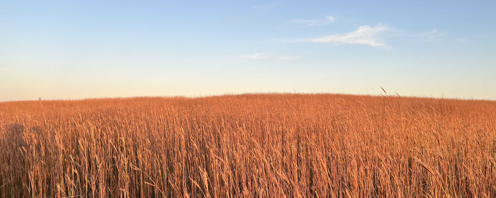
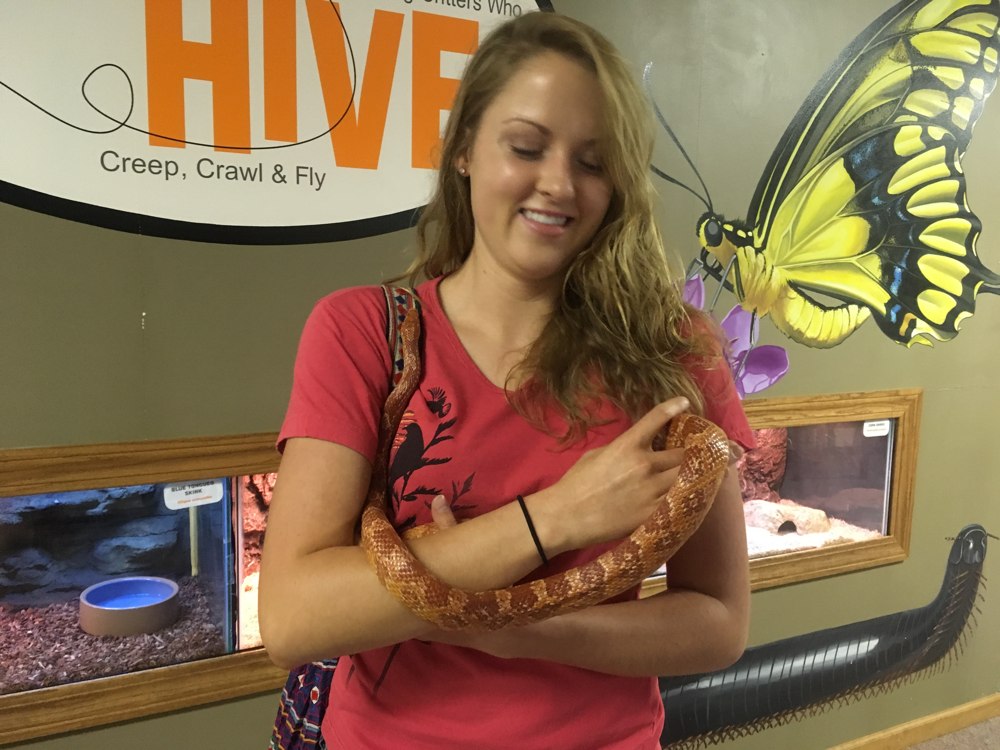
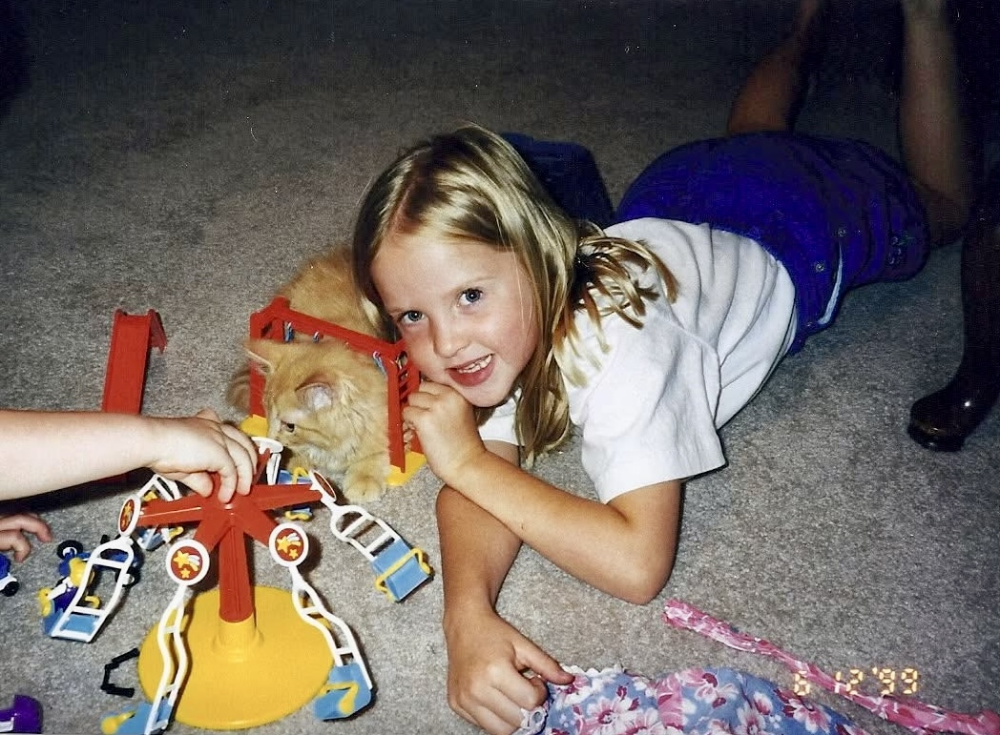
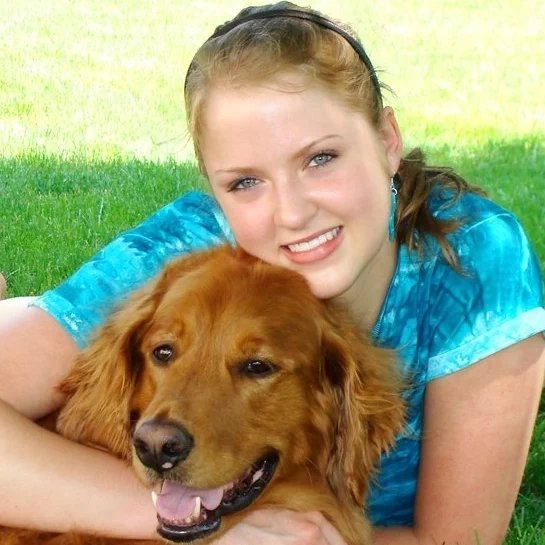
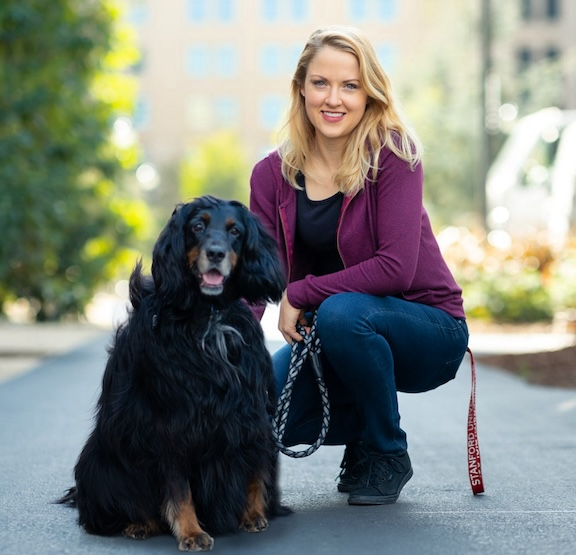

  

  

    

      

        “I felt that the grass was the country, as the water is the sea. ... And there was so much motion in it; the whole country seemed, somehow, to be running.”
      

      

        — Willa Cather, <em>My Ántonia</em>
      

    

  

  Spring Creek Prairie Audubon Center in Denton, Nebraska. Photo by Kate Lagerstrom.

I am a microbial ecologist and postdoctoral researcher in the Department of Ecology and Evolutionary Biology at Princeton University. I study how human activities reshape wildlife-associated microbial communities, with implications for animal health, conservation, and the interconnected health of humans, animals, and their environments.

My current research examines how pollution, habitat transformation, and altered contact between humans and wildlife influence the transmission and evolution of host-associated bacteria. I combine comparative and strain-resolved metagenomics with experimental approaches to investigate whether human-associated microbes establish in animal microbiomes and how exposure to antibiotics and agrochemicals may affect microbial communities and antimicrobial resistance.

I completed my Ph.D. in Biology at Stanford University, where my dissertation explored the ecology and genomic diversity of <i>Escherichia coli</i> in wild animals living at the wildland–urban interface. This work revealed extensive and previously underappreciated bacterial diversity within a single wildlife community, including antimicrobial-resistant, potentially pathogenic, and human-associated strains.

Across my work, I aim to understand how environmental change affects the microscopic communities on which animals depend—and how studying these interactions can support wildlife conservation and One Health.

## Science communication & recognition

In 2026, I was honored to be selected as one of five awardees of the **L'Oréal-UNESCO For Women in Science US program**, which recognizes and supports women postdoctoral researchers in the United States. The award has supported and amplified my research on how human activities reshape wildlife microbiomes, with implications for wildlife conservation and the interconnected health of animals, people, and the environment.

As part of this recognition, I was featured in a short documentary produced by Vox Creative, part of Vox Media, highlighting my research and the importance of understanding how human activities affect the microbial communities associated with wildlife.

  

    <button
      type="button"
      aria-label="Play my Vox Creative documentary"
      onclick="var p=this.parentElement; var v=document.createElement('iframe'); v.src='https://www.youtube.com/embed/VQBGKwW1NDQ?autoplay=1'; v.title='Kate Lagerstrom - Vox Creative Documentary'; v.setAttribute('allow','autoplay; encrypted-media; picture-in-picture; fullscreen'); v.setAttribute('allowfullscreen',''); v.style.cssText='position:absolute;inset:0;width:100%;height:100%;border:0;'; p.replaceChildren(v);"
      style="position:absolute; inset:0; width:100%; height:100%; padding:0; border:0; cursor:pointer; background:url('/images/vox-documentary-poster.jpg') center/cover no-repeat; display:flex; align-items:center; justify-content:center;">

      
        &#9654;
      

    </button>

  

  

    Documentary produced by Vox Creative for the L'Oréal-UNESCO For Women in Science US program.
    <a href="https://youtu.be/VQBGKwW1NDQ" target="_blank" rel="noopener noreferrer">Watch on YouTube</a>
    ·
    <a href="https://www.vox.com/ad/506492/wildlife-microbes-human-impact" target="_blank" rel="noopener noreferrer">Read the Vox feature</a>.
  

## Beyond research

I grew up in Nebraska and spent much of my childhood outdoors with my brother and the neighborhood kids—riding bikes, collecting insects in bug boxes, digging for worms, and usually coming home covered in mud. We even used to raid my mom's kitchen for pots and pans and set up camp under the porch, pretending we were the Boxcar Children. Summer nature camps and annual visits to the native tallgrass prairie remain some of my favorite childhood memories. I also couldn't get enough of Steve Irwin. I watched episodes of *The Crocodile Hunter* on repeat, captivated by his infectious enthusiasm and passion for wildlife. I still admire his remarkable ability to inspire others to care about animals. Watching his shows also made me determined to have a snake of my own. After nearly a year of pleading (while my mom waited to see whether it was just a phase), she finally agreed when I was eight, and I named my new coral-colored corn snake Freckles. Over the years, the menagerie also included Chester, an exceptionally dog-like cat; my best buddy Milo, a golden retriever; two mallard ducks, Peanut and Lucky; a white mouse named Sir Speedy; and several betta fish, many of which my brother named Louie (I, II, III, and so on).

Near the end of college, I spent a semester abroad in New Zealand and traveled through Southeast Asia, still figuring out what I wanted to do next. The landscapes were breathtaking, but what stayed with me just as strongly was the realization that even seemingly remote places aren't untouched by human activity. Those experiences helped clarify something important: whatever I did, I wanted my work to help protect the environment and the people and animals who depend on it. These days, Kona, my sweet Gordon setter, keeps me company on outdoor adventures and, more often, on the couch. Outside of research, I enjoy reading, playing piano, yoga, cooking, baking, and exploring new places.

  

    
    
<strong>Freckles</strong>

  

  

    
    
<strong>Chester</strong>

  

  

    
    
<strong>Milo</strong>

  

  

    
    
<strong>Kona</strong>

  

[Learn more about my research](/research/) or view my [publications](/publications/) and [CV](/cv/).