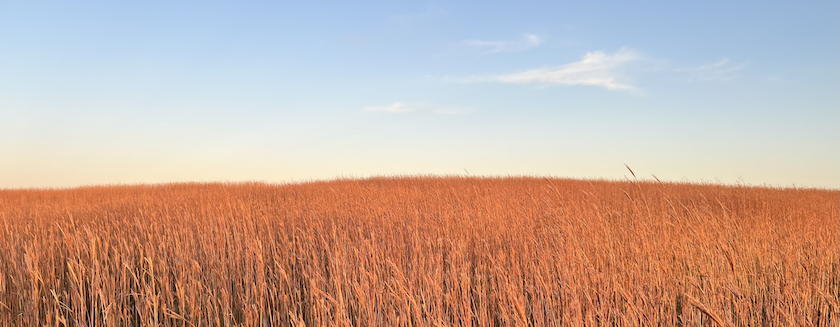

“As I looked about me, I felt that the grass was the country, as the water is the sea. The red of the grass made all the great prairie the color of wine stains, or of certain seaweeds when they are first washed up. And there was so much motion in it; the whole country seemed, somehow, to be running.” 
— **Willa Cather, <i>My Ántonia</i>**
{: .notice}

I am a microbial ecologist and postdoctoral researcher in the Department of Ecology and Evolutionary Biology at Princeton University. I study how human activities reshape wildlife-associated microbial communities, with implications for animal health, conservation, and the interconnected health of humans, animals, and their environments.

My current research examines how pollution, habitat transformation, and altered contact between humans and wildlife influence the transmission and evolution of host-associated bacteria. I combine comparative and strain-resolved metagenomics with experimental approaches to investigate whether human-associated microbes establish in animal microbiomes and how exposure to antibiotics and agrochemicals may affect microbial communities and antimicrobial resistance.

I completed my Ph.D. in Biology at Stanford University, where my dissertation explored the ecology and genomic diversity of <i>Escherichia coli</i> in wild animals living at the wildland–urban interface. This work revealed extensive and previously underappreciated bacterial diversity within a single wildlife community, including antimicrobial-resistant, potentially pathogenic, and human-associated strains.

Across my work, I aim to understand how environmental change affects the microscopic communities on which animals depend—and how studying these interactions can support wildlife conservation and One Health.

Beyond research
---------------
I grew up in Nebraska, where summer nature camps, annual visits to the native tallgrass prairie, and many hours spent watching Steve Irwin fostered my fascination with wildlife. The Crocodile Hunter inspired me to want a snake, and after nearly a year of pleading—while my mom waited to see whether it was only a passing phase—she finally agreed when I was eight. I named my new coral-colored corn snake Freckles. She joined a lively menagerie that included my best buddy Milo, a golden retriever, two mallard ducks, a white mouse, and several betta fish. Outside of research, I enjoy reading, yoga, traveling, and spending time outdoors with my Gordon Setter, Kona.

  

[Learn more about my research](/research/) or view my [publications](/publications/) and [CV](/cv/).