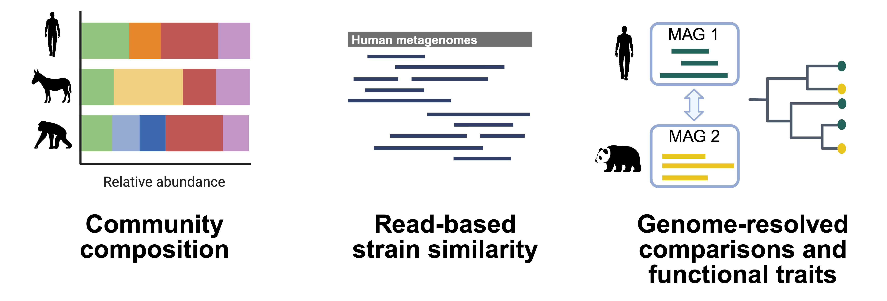

Captive animals experience dramatically different environments and much greater exposure to humans than their free-living counterparts. These changes are often accompanied by substantial restructuring of their gut microbiomes, including shifts toward more human-associated community states. However, the mechanisms underlying this “humanization” remain unresolved. Similar patterns could arise because captive animals and humans experience parallel ecological pressures, or because human-associated bacteria are directly transmitted to and colonize captive hosts.
### What causes microbiome “humanization” in captivity?
<figure style="margin:1.75rem auto; max-width:850px; text-align:center;">
  
</figure>
**Figure 1.** Two non-mutually exclusive mechanisms may contribute to microbiome humanization in captivity: parallel ecological selection and transmission of human-associated bacteria. [Created in BioRender](https://BioRender.com/5fs22x9).
{: .notice}

To distinguish between these possibilities, I use comparative, species-resolved, and strain-resolved metagenomics to analyze mammalian gut microbiomes from captive and wild conspecifics alongside humans. My work shows that captivity reshapes gut community composition and increases the prevalence of human-associated bacterial species in captive animals. At finer genomic resolution, captive animals also share highly similar bacterial strains with humans, consistent with recent cross-host transmission. These patterns vary among host species, suggesting differences in susceptibility to microbial colonization and persistence.
### Three approaches to test strain sharing between humans and captive animals
<figure style="margin:1.75rem auto; max-width:850px; text-align:center;">
  
</figure>
**Figure 2.** Three complementary analytical scales connect community-level shifts toward human-associated microbiomes with read-based strain similarity and genome-resolved evidence of microbial sharing and functional traits. [Created in BioRender](https://BioRender.com/5fs22x9).
{: .notice}

An important next step is determining whether these newly shared strains are beneficial, neutral, or detrimental to their animal hosts. Ongoing analyses focus on the metabolic potential and antimicrobial resistance profiles of high-confidence shared strains. More broadly, this work examines how microbial exchange in human-dominated environments may affect animal health and how strain-resolved microbiome surveillance could inform conservation efforts and the management of captive populations.

<figure style="margin:2rem auto 1rem auto; max-width:820px; text-align:center;">
  
</figure>
**Figure 3.** Factors shaping wildlife microbiomes in captivity are shown in orange; potential consequences for host health are shown in green; and broader One Health and conservation implications—including antimicrobial resistance and zoonotic disease risk—are shown in purple. Adapted from Lagerstrom et al. (2023). [Created in BioRender](https://BioRender.com/5fs22x9).
{: .notice}