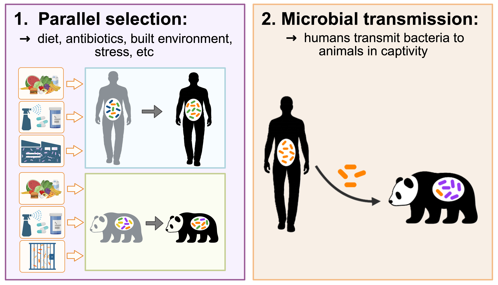
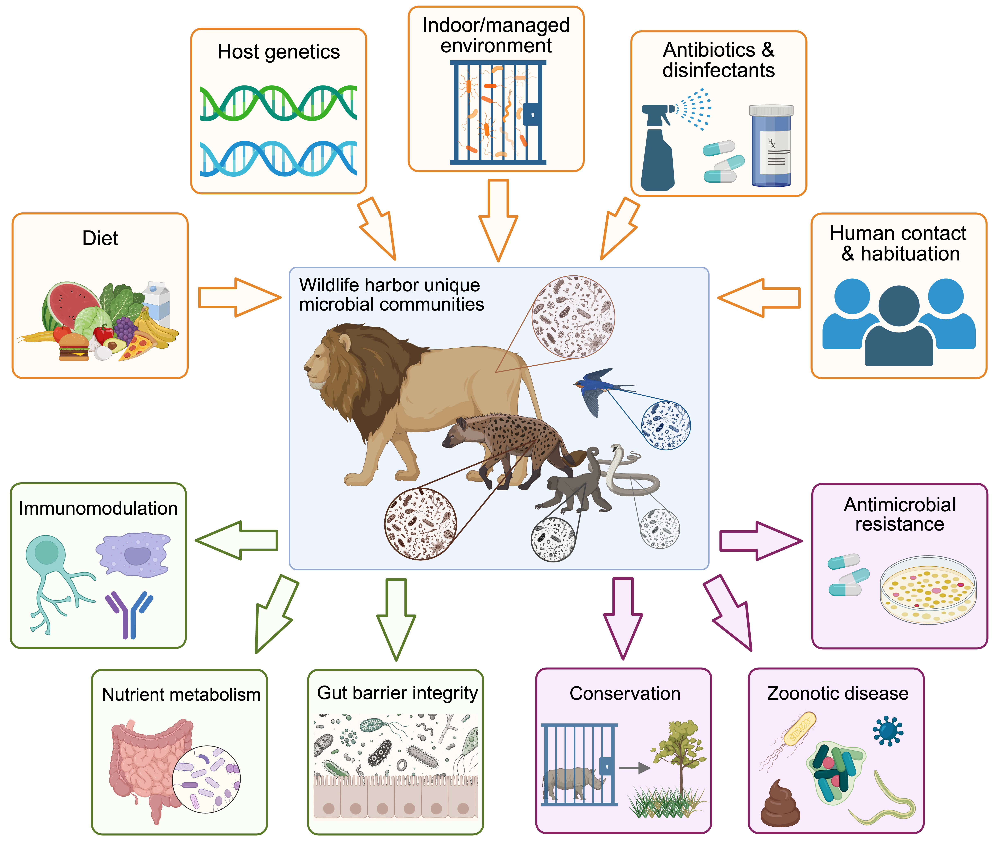

Captive animals experience dramatically different environments and much greater exposure to humans than their free-living counterparts. These changes are often accompanied by substantial restructuring of their gut microbiomes, including shifts toward more human-associated community states. However, the mechanisms underlying this “humanization” remain unresolved.

### What causes microbiome “humanization” in captivity?

<figure style="margin:1.75rem auto; max-width:850px; text-align:center;">
  
</figure>

**Figure 1.** Two non-mutually exclusive mechanisms may contribute to microbiome humanization in captivity: parallel ecological selection and transmission of human-associated bacteria. [Created in BioRender](https://BioRender.com/5fs22x9).
{: .notice}

My research examines whether microbiome restructuring in captivity primarily reflects shared ecological pressures or the transmission of human-associated bacteria into animal microbiomes. Using comparative and strain-resolved metagenomic approaches, I study how captivity reshapes host-associated microbial communities across mammalian hosts.

More broadly, this work asks what microbial exchange in human-dominated environments may mean for animal health, conservation, and One Health. A central goal is to understand when changes to wildlife microbiomes are transient, persistent, beneficial, or potentially harmful.

<figure style="margin:2rem auto 1rem auto; max-width:820px; text-align:center;">
  
</figure>

**Figure 2.** Factors shaping wildlife microbiomes in captivity are shown in orange; potential consequences for host health are shown in green; and broader One Health and conservation implications—including antimicrobial resistance and zoonotic disease risk—are shown in purple. Adapted from Lagerstrom et al. (2023). [Created in BioRender](https://BioRender.com/5fs22x9).
{: .notice}

*This research is ongoing.*