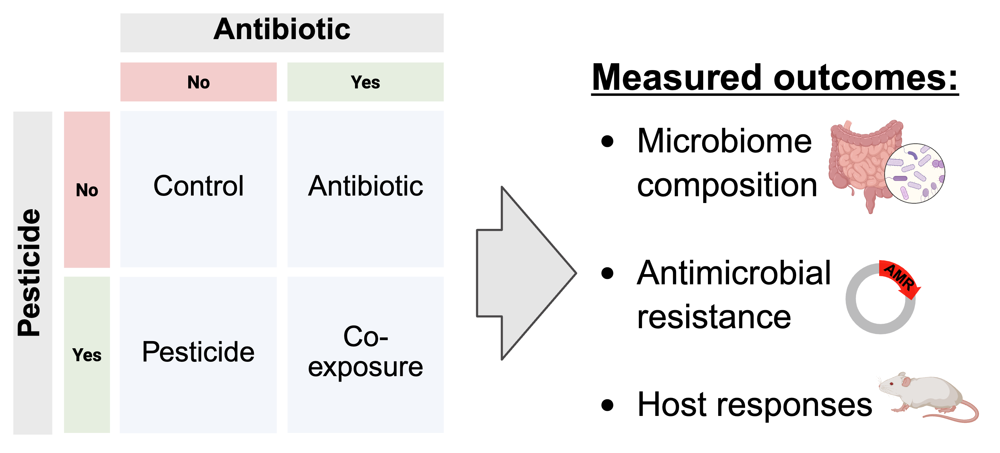

Antibiotics, pesticides, and other environmental pollutants frequently co-occur in agricultural runoff, wastewater, and other human-impacted environments. However, their biological effects are often studied in isolation. This is an important limitation because non-antibiotic pollutants can alter bacterial responses to antibiotics, promote the movement of antimicrobial resistance genes (ARGs), and potentially accelerate the evolution of antimicrobial resistance (AMR) within complex microbial communities.

<figure style="margin:1.75rem auto; max-width:900px; text-align:center;">
  
</figure>
**Figure 1.** Conceptual overview of the co-exposure framework, showing factorial antibiotic and pesticide treatments and the major classes of outcomes measured: microbiome composition, antimicrobial resistance, and host responses. [Created in BioRender](https://BioRender.com/5fs22x9).
{: .notice}

My research investigates how combined exposure to antibiotics and pesticides reshapes host-associated microbiomes and influences the emergence and spread of AMR. Rather than focusing on individual bacterial species, this work examines resistance as an outcome of interactions among chemical stressors, microbial community structure, and evolutionary processes. I am developing a framework that combines controlled exposure experiments with strain-resolved metagenomics to track changes in community composition, resistance genes, bacterial lineages, and the genomic mechanisms underlying resistance.

The broader project will connect experiments in cultured synthetic microbial communities with studies in animal models to determine whether pollutant combinations produce effects that cannot be predicted from exposure to either compound alone. Future phases will also examine whether pollutant-driven changes to the microbiome alter host tolerance to chemical stress. An initial set of complementary undergraduate projects is exploring how antibiotic and agrochemical co-exposure affects microbial communities associated with the gut, oral cavity, and skin.

By moving beyond single-compound and single-species approaches, this research aims to clarify how realistic environmental pollutant mixtures shape AMR across biological scales. Ultimately, this work may improve our understanding of environmental contributions to resistance and inform wildlife conservation, public health, and environmental risk assessment.

*This research is ongoing.*