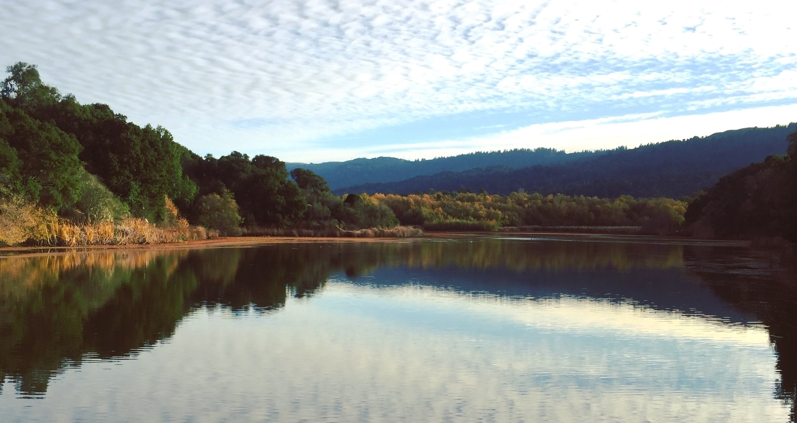
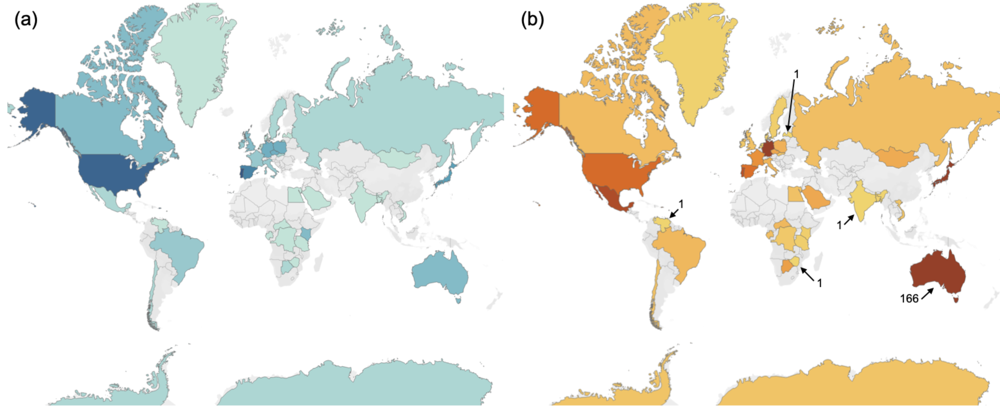
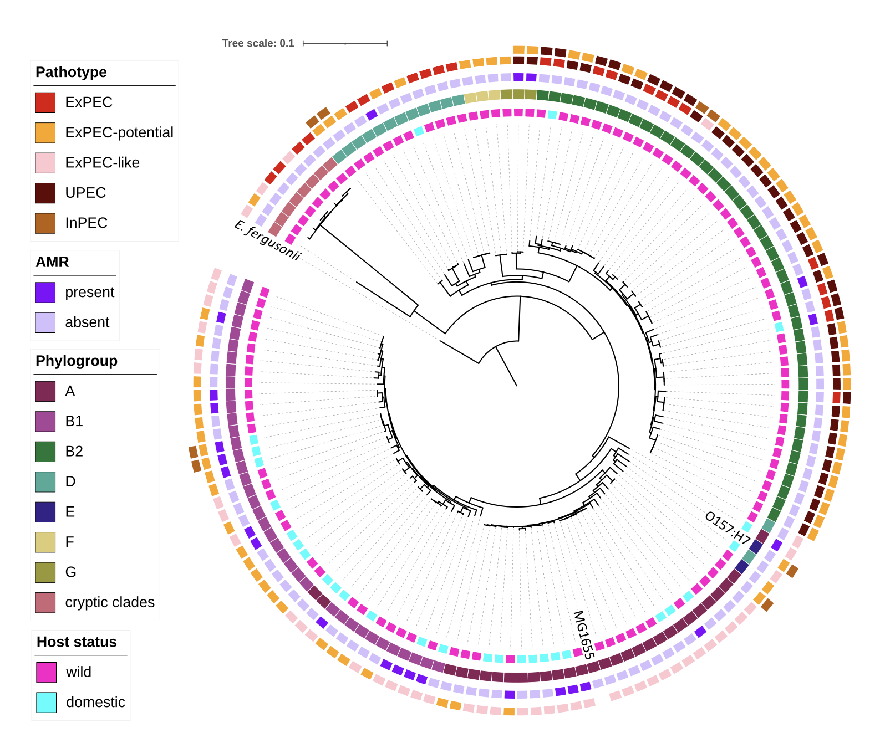
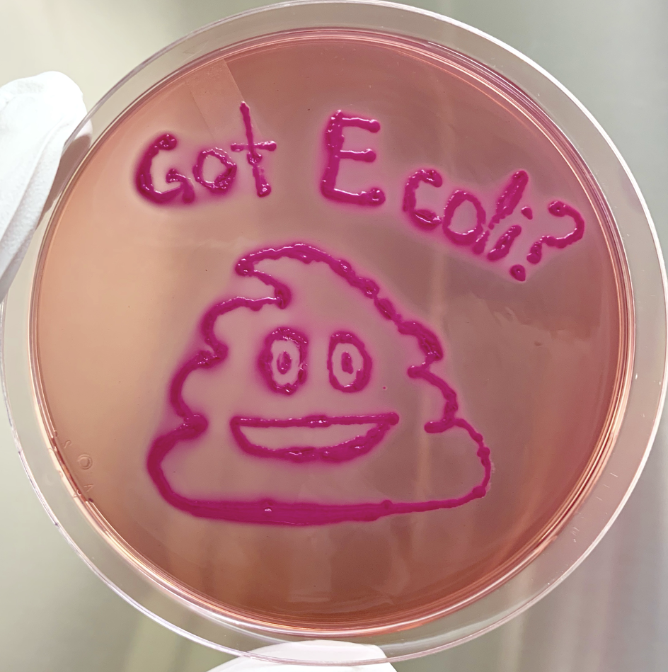

My doctoral research examined how human activity influences the ecology and evolution of <i>Escherichia coli</i> in wildlife at the wildland–urban interface. Although <i>E. coli</i> is among the best-studied bacteria in humans and domestic animals, its diversity and ecology in free-living wildlife remain surprisingly poorly understood.

Wild animals are often viewed primarily as potential sources of pathogenic <i>E. coli</i>. However, microbial exchange can occur in both directions: human-associated bacteria may also enter wildlife communities through urban development, wastewater, agricultural runoff, and other forms of environmental contamination.

Across three linked studies, I investigated how comprehensively <i>E. coli</i> diversity has been characterized in wildlife, how deeply wild hosts must be sampled to recover that diversity, and what whole genomes can reveal about antimicrobial resistance, virulence, and potential microbial exchange across the human–wildlife interface.

## Identifying gaps in wildlife research

I began with a global [scoping review](/files/Lagerstrom_2021.pdf) of research on <i>E. coli</i> in wild animals. The review revealed substantial geographic and taxonomic biases in the existing literature, as well as important limitations in commonly used sampling and analytical approaches. Large regions of the world and many wildlife groups remained almost entirely unstudied.

**Geographic and taxonomic gaps in research on <i>E. coli</i> in wild animals.** Countries are shaded according to the number of eligible studies (a) and wild animal host species represented in the published literature (b); darker colors indicate a greater number of studies or represented host species, respectively, whereas gray indicates countries not represented in the eligible literature. From Lagerstrom and Hadly, 2021.
{: .notice}

## Sampling a wild animal community

To address these gaps, I surveyed 163 scat samples from 17 vertebrate host species at Jasper Ridge Biological Preserve in California and recovered nearly 1,800 <i>E. coli</i> isolates.

The diversity detected within and among host species depended strongly on sampling depth. Several patterns previously attributed to host biology became much less convincing when more isolates and individuals were sampled. This work demonstrated the importance of using ecologically informed sampling standards before drawing conclusions about the distribution of bacterial diversity in wildlife.

[Read the full study.](/files/Lagerstrom_2023.pdf)

## Resolving diversity at the genome level

I then used whole-genome sequencing to characterize 143 representative isolates from the Jasper Ridge wildlife community. These genomes encompassed all eight major <i>E. coli</i> phylogroups, two cryptic clades, and 89 sequence types.

Seventeen percent of the isolates carried one or more antimicrobial resistance genes, 46% carried combinations of virulence factors consistent with recognized pathotypes, and approximately one-fifth belonged to sequence types strongly associated with humans. These findings show that a single wildlife community can contain extensive global bacterial diversity and clinically relevant traits, while also preserving possible signatures of human influence.

**Genetic and ecological structure of <i>E. coli</i> from Jasper Ridge.** The phylogeny contains 143 newly sequenced wildlife-associated genomes. Colored rings indicate host status, phylogroup, antimicrobial resistance, and pathotype. From Lagerstrom et al., 2024; graphic created using iTOL.
{: .notice}

[Read the full study.](/files/Lagerstrom_2024.pdf)

## The broader picture

  

    

      Together, this research showed that the microbial communities of wild animals cannot be understood in isolation from human activities. Wildlife may harbor and disperse microorganisms relevant to public health, but they are also recipients of human-associated bacteria and environmental pollutants.
    

    

      This work provided the foundation for my current research on
      <a href="/research/captivity/">microbial transmission in captivity</a>
      and
      <a href="/research/coexposure/">pollutant co-exposure and antimicrobial resistance</a>.
    

  

  <figure style="flex:0 1 210px; max-width:210px; margin:0 auto; text-align:center;">
    

    <figcaption style="font-size:0.78em; line-height:1.35; color:#666; margin-top:0.45rem;">
      “Got <i>E. coli</i>?” drawn using an isolate recovered from a wild animal at Jasper Ridge.
    </figcaption>
  </figure>

