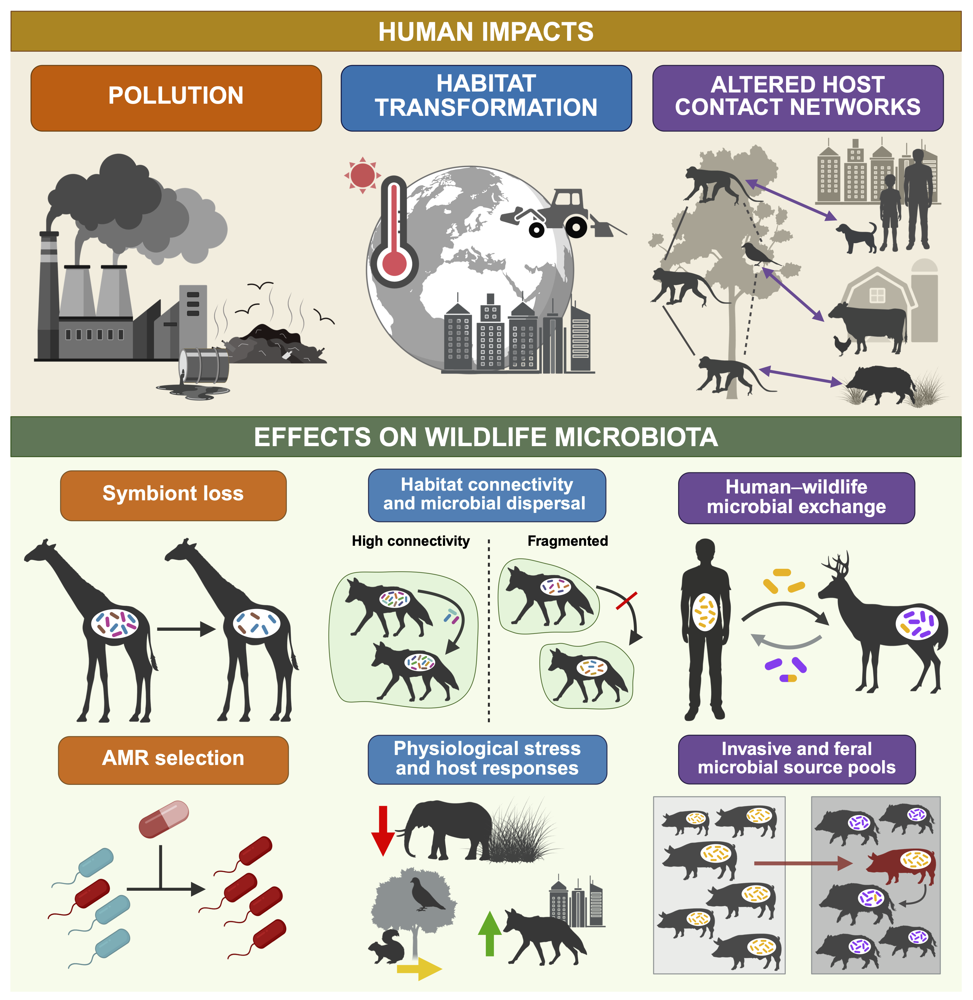

I study how human activities reshape the microbial communities associated with wildlife. My research examines how pollution, habitat transformation, and altered contact among humans and animals influence microbial community structure, bacterial transmission, antimicrobial resistance, and host health.

By combining ecological theory with comparative, experimental, and strain-resolved genomic approaches, I aim to understand whether human-driven microbiome changes are temporary or persistent, beneficial or harmful, and whether they meaningfully affect wildlife conservation and One Health.

[**↓ Explore my research projects**](#research-projects)

## A framework for understanding human impacts on wildlife microbiomes

In our recent [*PLOS Biology* article, “How do anthropogenic changes affect wildlife microbiomes?”](https://doi.org/10.1371/journal.pbio.3003939), we explore three interacting ways that human activities reshape wildlife-associated microbial communities: **pollution, habitat transformation, and altered host contact networks**. This framework brings together many of the questions driving my current and previous research, from antimicrobial resistance and microbial transmission to the consequences of environmental change for wildlife health.

<figure style="max-width:690px; margin:1.5rem auto 2rem; text-align:center;">

  

  <figcaption style="font-size:0.85em; color:#666; text-align:left; margin-top:0.75rem;">
    <strong>Figure 1.</strong> Human impacts on wildlife microbiota.
    From <a href="https://doi.org/10.1371/journal.pbio.3003939">Lagerstrom et al. (2026), PLOS Biology</a> (CC BY 4.0).
    <a href="https://BioRender.com/5fs22x9">Created in Biorender</a>.
    Click the figure to enlarge.
  </figcaption>

</figure>

<h2 id="research-projects">Explore my research projects</h2>
  

  

    <h2 style="margin-top:0; font-size:1.25em;">Microbial transmission in captivity</h2>

    

      Captive animals often develop gut microbiomes that resemble those of humans. I use community-, strain-, and genome-resolved metagenomics to investigate whether this “humanization” reflects shared environmental pressures, microbial transmission, or both.
    

    

      <a href="/research/captivity/"><strong>Explore this project →</strong></a>
    

  

  

    <h2 style="margin-top:0; font-size:1.25em;">Pollutant co-exposure and antimicrobial resistance</h2>

    

      Antibiotics and pesticides frequently occur together in human-impacted environments. I investigate how realistic pollutant mixtures reshape host-associated microbiomes and influence the evolution and spread of antimicrobial resistance.
    

    

      <a href="/research/coexposure/"><strong>Explore this project →</strong></a>
    

  

  

    <h2 style="margin-top:0; font-size:1.25em;">The wild side of <i>E. coli</i></h2>

    

      My doctoral research examined the diversity, ecology, and genomic characteristics of <i>Escherichia coli</i> in a wild animal community at the wildland–urban interface, including evidence of antimicrobial resistance and human influence.
    

    

      <a href="/research/dissertation/"><strong>Explore my dissertation research →</strong></a>
    

  

